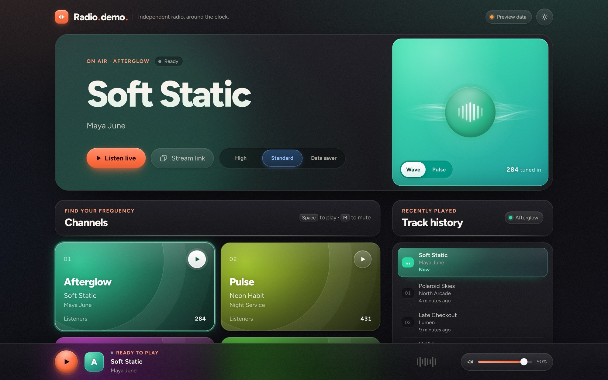
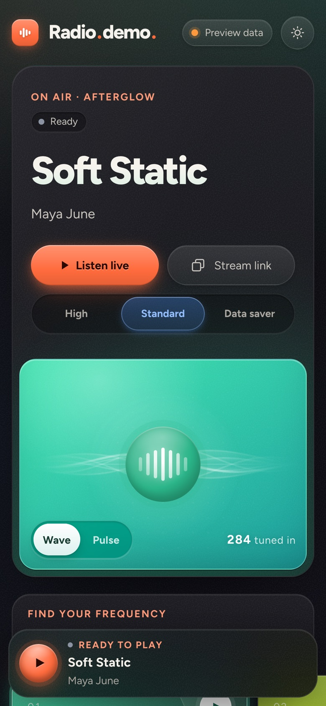

# Radio.demo — Live radio UI

**[Live demo](https://devsajjadx.github.io/Radio-UI/)**

<p>
  
  
</p>

A UI demo for a multi-channel internet radio player: responsive, plain HTML, CSS and JavaScript modules — no framework, no build step, no dependencies.

This project is the front end only. There is no backend: everything you see comes from sample data, and the play button has no real stream behind it. Hook it up to whatever station or API you like.

- Channel cards with listener counts, now playing and a recently played list
- Stream quality switch (e.g. 192 / 128 / 64 kbps)
- Canvas audio visualizer with two styles (Wave, Pulse)
- Light and dark themes, following the OS setting until you pick one
- Each channel tints the whole interface with its own hue
- Keyboard shortcuts: <kbd>Space</kbd> or <kbd>K</kbd> play/stop, <kbd>M</kbd> mute

## Run it

Serve the `dist/` folder with any static file server, for example:

```bash
python3 -m http.server 5173 --directory dist
```

Then open <http://localhost:5173>. Because the scripts are ES modules, opening `dist/index.html` straight from disk won't work — use a server, or the standalone build below.

## Standalone build

`build-standalone.py` bundles `dist/` (styles, scripts and fonts) into a single self-contained HTML file that also works when opened from disk:

```bash
python3 build-standalone.py               # writes signal-radio-standalone.html
python3 build-standalone.py --history 40  # pad each channel's preview history to 40 tracks
```

## Customizing

The station name, tagline, channels, tracks and stream qualities are all sample data in `fallbackData` at the top of `dist/app.js` — edit them freely.

## Project layout

```
dist/                   the site
  index.html
  styles.css
  app.js                data, playback and rendering
  visualizer.js         canvas visualizer
  assets/fonts/         Figtree (woff2, latin + latin-ext)
proposal/               staging copy of dist/ with stress-test data (very long titles and names)
build-standalone.py     single-file bundler
docs/screenshots/       images used in this README
```

## License

Code: [MIT](LICENSE).

## Credits

Typeface: [Figtree](https://github.com/erikdkennedy/figtree) by Erik Kennedy, licensed under the SIL Open Font License 1.1 (see `dist/assets/fonts/OFL.txt`).
